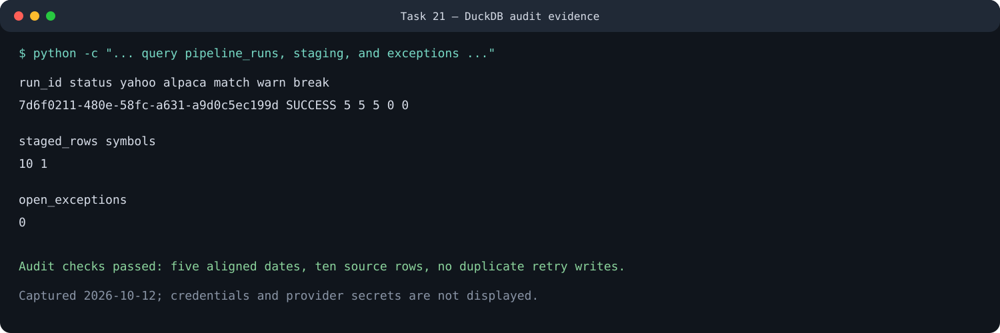
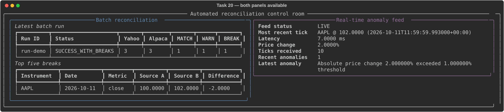
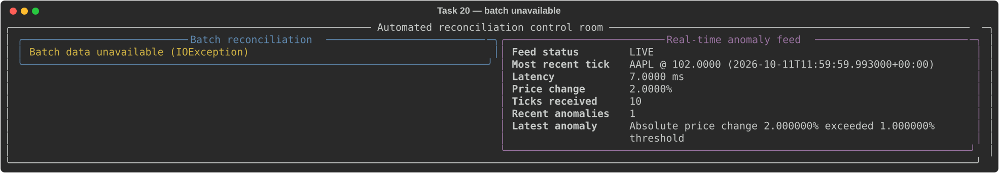
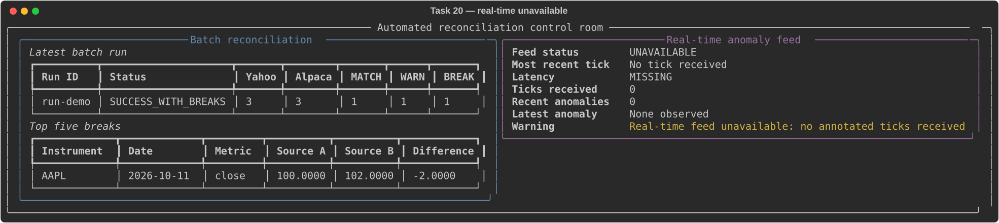

# Automated Financial Data Ingestion & Reconciliation Engine

A Python reconciliation engine for equities, equity options, and futures using Yahoo Finance, Alpaca, and Massive.

```text
Yahoo + Alpaca + Massive -> normalize -> DuckDB + Parquet
                                      -> provider-pair reconciliation
                                      -> exceptions + dbt facts + dashboard

simulated ticks -> ZeroMQ -> anomaly scorer -> ZeroMQ -> read-only dashboard
```

The equity three-provider batch and simulated real-time paths are runnable.
Options and futures have provider-aware ingestion and reconciliation libraries;
their persisted batch orchestration remains planned. See the [operator runbook](docs/RUNBOOK.md)
for end-to-end commands and failure handling.

## Visual Walkthrough

### 1. Run the batch control

```sh
python -m reconciliation_engine.batch --symbol AAPL
```

The command fetches all three providers, reconciles every provider pair, stores one
auditable `run_id`, and creates exceptions for breaks. This verified example
aligned eight market dates across three providers and produced 24 pairwise
matches with no breaks:



### 2. Start the live control room

Run the scorer, dashboard, and simulated publisher in separate terminals as
shown in [Run the Real-Time Feed](#run-the-real-time-feed). The healthy view
combines the latest DuckDB batch state with annotated ZeroMQ ticks:



### 3. Recognize degraded operation

The two panels fail independently, so an operator can immediately distinguish
a database problem from a real-time feed problem.

**Batch unavailable:** the live tick panel remains usable.



**Real-time feed unavailable:** the stored batch panel remains usable.



These are synthetic, non-sensitive captures. The exact verification commands
and results are recorded in [Release Evidence](docs/RELEASE_EVIDENCE.md).

## Current MVP

- Normalized Yahoo Finance equity bars: `symbol, trade_date, open, high, low, close, volume`
- Normalized Yahoo Finance option chains for calls and puts
- Normalized Alpaca option chains using the same canonical option schema
- Normalized Alpaca daily equity bars using the same equity schema
- Normalized Massive equity, option, and futures data behind one quota controller
- Equity facts for Yahoo/Alpaca, Yahoo/Massive, and Alpaca/Massive
- Versioned dbt models for typed staging, provider pairing, and reconciliation facts
- Offline-tested three-provider option reconciliation by full contract identity
- Yahoo/Massive futures reconciliation with mandatory contract-roll mapping
- `MATCH` / `WARN` / `BREAK` status using explicit close-price tolerances
- Immutable raw and normalized Parquet archives partitioned by source and run ID
- Deterministic provider/symbol-bucket checkpoints with bounded parallel ingestion
- Partition metrics, quarantine records, structured events, and exception SLAs
- Authenticated read-only REST access with filtering, pagination, and exports
- OTLP traces, exported metrics, trace-correlated logs, and aggregated alerts
- Read-only DuckDB dashboard for latest breaks and operational analytics
- Local ZeroMQ publish/subscribe feed with deterministic simulated equity ticks
- Explainable prior-price anomaly scoring with a separate annotated-tick feed
- Non-root Docker Compose batch runner with persistent DuckDB and Parquet state
- Private local secret/database permissions and lazy credential loading

## Control Guarantees

| Concern | Product behavior |
| --- | --- |
| Missing provider observations | Every Yahoo/Alpaca/Massive provider pair uses a full outer comparison. A one-sided observation remains a `BREAK` with the missing provider named explicitly. |
| Provider alignment | All equity providers use the same configured window; Yahoo and Massive request unadjusted prices to align with Alpaca's raw IEX bars. Symbols and dates are normalized, and Python/dbt share hybrid limits: warning above the greater of `$0.01` or `0.10%`, break above the greater of `$0.05` or `0.50%`. |
| Data validation | Equity inputs reject missing columns, nulls, non-numeric OHLCV values, non-finite or negative values, duplicate `symbol/trade_date` keys, and inconsistent OHLC ranges. Numeric fractional aggregate volume is preserved because some providers report it. |
| Safe retries | The control date, sorted symbol universe, and rule version produce a deterministic run ID. A completed retry performs no provider calls or writes. DuckDB commits the run, stages, results, and exceptions in one transaction; interrupted Parquet writes are immutable and resumable. |
| Bounded scale | Symbols use stable hash buckets and each provider/bucket is independently retryable. Worker concurrency is capped, while Massive also enforces its shared calls-per-minute budget. |

Provider alignment does not imply identical prices. IEX versus broader-market
coverage, quote timing, and vendor policies can create legitimate differences;
the warning band keeps small differences visible without treating all of them
as critical breaks.

## Run

1. Copy `project.env.example` to `project.env`, add `ALPACA_API_KEY`,
   `ALPACA_SECRET_KEY`, and `MASSIVE_API_KEY`, then set the desired
   `RECONCILIATION_SYMBOLS` universe. Massive-backed commands share the
   `MASSIVE_CALLS_PER_MINUTE=5` safety limit. Use
   `RECONCILIATION_SYMBOL_BUCKETS` and `RECONCILIATION_MAX_WORKERS` to tune
   deterministic partitioning and bounded concurrency.
   On POSIX systems, run `chmod 600 project.env`.
2. Install dependencies with `pip install -r requirements.txt`.
3. Run the offline release check. It validates imports, configuration, local
   endpoints, and a temporary DuckDB schema without fetching market data:

```powershell
python -m reconciliation_engine.smoke
```

4. Run the reconciliation demo from the project root:

```powershell
python -m reconciliation_engine.batch
```

The command compares recent daily bars for the comma-separated symbols in
`RECONCILIATION_SYMBOLS` (default: `AAPL`), saves the audit trail to DuckDB, and
archives Yahoo, Alpaca, Massive, and reconciliation data under `data/`. Each archive
contains its `run_id` and an existing run file is never overwritten.

One logical run is allowed for each US-market control date, symbol universe,
and rule version. Retrying that combination returns the stored result without
calling either provider again. Use `--control-date` for a reproducible backfill:

```powershell
python -m reconciliation_engine.batch --symbol AAPL --control-date 2026-10-09
```

Override the configured universe for one run with one or more `--symbol`
arguments:

```powershell
python -m reconciliation_engine.batch --symbol MSFT
python -m reconciliation_engine.batch --symbol AAPL --symbol MSFT --symbol NVDA
python -m reconciliation_engine.batch --symbol AAPL,MSFT,NVDA
```

CLI symbols take precedence over `RECONCILIATION_SYMBOLS`. Symbols are
case-normalized, de-duplicated, and validated before either provider is called.
The dashboard requires no separate configuration: it reads the instruments
stored by the selected reconciliation run.

Replay a saved run without calling Yahoo, Alpaca, or Massive:

```powershell
python -m reconciliation_engine.batch --replay-run-id <run-id>
```

Provider files use this layout:

```text
data/raw/<SOURCE>/equities/run_id=<run-id>/payload.parquet
data/normalized/<SOURCE>/equities/run_id=<run-id>/data.parquet
data/reconciliation/equities/run_id=<run-id>/results.parquet
data/partitions/<raw|normalized>/control_date=<date>/instrument_type=EQUITY/symbol_bucket=<bucket>/provider=<SOURCE>/partition_id=<partition-id>/<file>.parquet
```

See [Scalability and Deployment Model](docs/SCALABILITY.md) for partition
retries, provider isolation, retention, operational metrics, and the production
transition from local DuckDB to object storage plus transactional workflow state.

## Read-only REST API

After a reconciliation has been persisted, start the export service:

```sh
python -m reconciliation_engine.api --db reconciliation.duckdb
```

The service provides authenticated run history, reconciliation and exception
filters, and CSV/JSON/Parquet downloads. `/health` is public; all `/api/v1/*`
routes require `Authorization: Bearer <RECONCILIATION_EXPORT_API_KEY>`.

```text
GET /api/v1/runs
GET /api/v1/runs/{run_id}
GET /api/v1/reconciliations
GET /api/v1/exceptions
GET /api/v1/exports?format=csv
GET /health
```

See the [Export API guide](docs/EXPORT_API.md) for filters, pagination, download
examples, authentication, and the DuckDB single-writer operating model.

## Observability and alerting

Set `RECONCILIATION_OTEL_ENABLED=true` to export traces and metrics over
OTLP/HTTP. Batch runs, worker partitions, provider calls, reconciliation,
DuckDB reads, API requests, and exports are traced. Metrics cover run outcomes,
provider latency/failures, quarantines, API saturation, and alert delivery.

```sh
docker compose --env-file project.env -f observability/docker-compose.yaml up -d
python -m reconciliation_engine.alerts --db reconciliation.duckdb
```

The included local stack routes traces to Tempo and metrics to Prometheus, with
both available through Grafana. The alert evaluator sends aggregated webhook
alerts for failed partitions, provider health, and overdue exception SLAs. See
[OpenTelemetry and Alerting](docs/OBSERVABILITY.md) for configuration, signal
contracts, thresholds, and production controls.

Run the offline reconciliation tests without API credentials or network access:

```powershell
python -m unittest discover -s tests -v
```

The Python and dbt controls preserve observations available from only one
provider and classify them as breaks instead of silently dropping them.

Build the SQL transformation layer against the local DuckDB file:

```powershell
dbt build --project-dir dbt --profiles-dir dbt
```

Set `RECONCILIATION_DB_PATH` to target another DuckDB file. A successful build
creates the queryable `main.fct_equity_reconciliation` table with `MATCH`,
`WARN`, and `BREAK` outcomes. Close differences warn above the greater of
`$0.01` or `0.10%`; they break above the greater of `$0.05` or `0.50%`.
Missing closes always break.

## Run with Docker Compose

Docker runs only the one-shot batch pipeline. Airflow and the real-time feed are
intentionally outside this image.

1. Create `project.env` from `project.env.example`, replace the two Alpaca
   placeholders, set `RECONCILIATION_SYMBOLS`, and optionally set `WEBHOOK_URL`.
2. Build the minimal batch image:

```sh
docker compose -f orchestration/docker/compose.yaml build --pull
```

3. Run one reconciliation:

```sh
docker compose -f orchestration/docker/compose.yaml run --rm batch
```

For a one-off Docker override without editing `project.env`:

```sh
docker compose -f orchestration/docker/compose.yaml run --rm \
  -e RECONCILIATION_SYMBOLS=MSFT,NVDA batch
```

The named volume `automated-reconciliation-engine-state` retains
`reconciliation.duckdb` and the complete `data/` archive after the container
exits. Confirm persisted run count with:

```sh
docker compose -f orchestration/docker/compose.yaml run --rm \
  --entrypoint python batch -c "import duckdb; c=duckdb.connect('/app/state/reconciliation.duckdb', read_only=True); print(c.execute('select count(*) from pipeline_runs').fetchone()[0])"
```

Credentials are supplied from `project.env` at container runtime. The
deny-by-default `.dockerignore` prevents that file, local data, Git history, and
developer environments from entering the image build context.

## Run the Real-Time Feed

The initial feed is explicitly simulated and does not require API credentials.
Start the subscriber in one terminal:

```powershell
python -m reconciliation_engine.realtime.subscriber --count 10
```

Then start the publisher in another terminal:

```powershell
python -m reconciliation_engine.realtime.publisher --count 10
```

Both commands use `REALTIME_ZMQ_ENDPOINT`, which defaults to the local endpoint
`tcp://127.0.0.1:5555`. Each JSON tick contains exactly `symbol`, `price`,
`exchange_timestamp`, `received_timestamp`, and `latency_ms`. Omit `--count` to
run continuously and stop cleanly with Ctrl+C.

To score the simulated feed, start the scorer before the publisher:

```powershell
python -m reconciliation_engine.realtime.anomaly_scorer --count 10 --threshold-pct 0.1
```

Then run the publisher in another terminal:

```powershell
python -m reconciliation_engine.realtime.publisher --count 10
```

The scorer preserves every raw field and adds `pct_change`, `is_anomaly`, and
an explanatory `reason`. It republishes annotated ticks to
`REALTIME_SCORED_ZMQ_ENDPOINT`, which defaults to `tcp://127.0.0.1:5556`.
The default rule threshold is 1%; the lower `0.1` demo threshold intentionally
flags a movement in the deterministic simulated sequence. The optional
`isolation_forest_flags` function supports offline comparison without changing
the transparent rule used by the live scorer.

View a one-time reconciliation control-room snapshot. It remains usable when
either DuckDB or the annotated feed is unavailable:

```powershell
python -m reconciliation_engine.dashboard --db reconciliation.duckdb
```

Add `--refresh 0.5` for a continuously updating batch and real-time view:

```powershell
python -m reconciliation_engine.dashboard --db reconciliation.duckdb --refresh 0.5
```

The dashboard opens DuckDB in read-only mode and uses only a ZeroMQ `SUB`
socket. It displays the latest batch status and MATCH/WARN/BREAK counts, the top
five breaks, the most recent annotated tick and latency, anomalies observed in
the last 60 seconds, and the latest anomaly reason. Refresh requests below 0.5
seconds are bounded to 0.5 seconds.

| Panel | Operator question |
| --- | --- |
| Batch reconciliation | Did the control complete, what matched/warned/broke, and which five breaks are largest? |
| Real-time anomaly feed | What was the latest tick and latency, and were recent movements anomalous? |

Start the anomaly scorer and simulated publisher as shown above to populate the
live panel. See [Dashboard degraded-mode demonstrations](docs/DASHBOARD_DEMO.md)
for captured examples of both panels available and each independent failure.

## Schedule the Daily Control

See [docs/SCHEDULING.md](docs/SCHEDULING.md) for complete Windows Task Scheduler
and Ubuntu cron setup. Both schedules run at 4:30 PM America/New_York on
weekdays, after the regular US equity-market close.

## Data Security

- Keep `project.env` local and set its permissions to owner-only (`chmod 600 project.env` on Linux/macOS).
- Rotate credentials immediately if they are printed, shared, or committed.
- API clients load credentials only when a provider call is made; tests and analytics do not need secrets.
- DuckDB files are restricted to the current OS user when initialized.
- The dashboard reads curated reconciliation results and aggregate metrics, not raw credential or payload data.
- The REST API requires a bearer token and exposes only curated read-only views and bounded exports.
- If a key may have been exposed, revoke or rotate it at Alpaca or Massive as applicable; changing the local file does not invalidate a copied key.

See [docs/DATA_SECURITY.md](docs/DATA_SECURITY.md) for the threat model and production controls.
See [DATA_SOURCES.md](DATA_SOURCES.md) for provider coverage, entitlements,
synthetic inputs, and licensing caveats.

## Project Structure

```text
Automated-reconciliation-engine/
├── reconciliation_engine/        # Python application package
│   ├── batch.py                   # Daily batch command and archive replay
│   ├── dashboard.py               # Read-only reconciliation dashboard
│   ├── notifications.py           # Break and failure notifications
│   ├── security.py                # Credentials and file permissions
│   ├── smoke.py                   # Offline release-readiness checks
│   ├── api/                       # Authenticated read-only FastAPI service
│   ├── ingestion/                 # Provider adapters and normalization
│   │   ├── alpaca_equities.py
│   │   ├── alpaca_options.py
│   │   ├── massive.py             # Shared auth, quota, retry, pagination
│   │   ├── massive_equities.py
│   │   ├── massive_options.py
│   │   ├── massive_futures.py
│   │   ├── providers.py           # Canonical provider adapter contract
│   │   ├── yahoo_equities.py
│   │   ├── yahoo_options.py
│   │   └── futures.py
│   ├── scaling/                   # Stable partitions and bounded execution
│   ├── reconciliation/            # Comparison rules and exceptions
│   │   ├── equities.py
│   │   ├── options.py
│   │   └── exceptions.py
│   ├── storage/                   # Durable local data interfaces
│   │   ├── duckdb.py
│   │   ├── data_lake.py
│   │   ├── partitioned_data_lake.py
│   │   └── retention.py
│   └── realtime/                  # ZeroMQ publish/subscribe path
│       ├── anomaly_scorer.py       # Explainable real-time anomaly scoring
│       ├── publisher.py
│       └── subscriber.py
├── dbt/                           # Versioned DuckDB SQL transformations
│   ├── models/
│   └── tests/
├── tests/                         # Offline unit and integration tests
├── docs/                          # Architecture, operations, and security
│   └── RUNBOOK.md                 # End-to-end operator and release runbook
├── orchestration/                 # Deployment and future scheduling
│   └── docker/                    # Batch image and Compose definition
├── project.env.example            # Safe configuration template
├── pyproject.toml                 # Python project and dependencies
└── README.md
```

Application code belongs inside `reconciliation_engine/`; SQL transformations
belong inside `dbt/`; automated checks belong inside `tests/`; and operational
guidance belongs inside `docs/`. Runtime databases, Parquet data, logs, virtual
environments, and generated dbt artifacts stay local through `.gitignore`.
See [Codebase Organization](docs/CODEBASE_ORGANIZATION.md) for the placement
rules used throughout the project.

## Options Data Availability

Comparable option contracts may be unavailable because of account entitlements, subscription level, expiration, or provider coverage. The project does not replace missing observations with another provider's values or synthetic prices and does not report an unavailable comparison as a `MATCH`.

When one provider returns no option contracts, every contract from an available provider is retained as a pair-specific `BREAK`. A provider pair returns no rows only when both sides are empty. Offline fixtures prove matched, price-break, missing-contract, snapshot-date, and duplicate-contract behavior independently of vendor access.

Massive adds option contract discovery and EOD aggregate bars. On the free
plan, quote, open-interest, IV, and Greek fields are not substituted with zeros
or inferred values; they remain unavailable. Massive also adds expiring
futures-contract and session-bar ingestion. Because Yahoo exposes continuous
futures while Massive exposes specific contracts, a configured roll mapping is
required before those records can become a valid reconciliation pair.

## Planned Next Steps

- Add persisted futures quality reporting with explicit continuous-to-expiring contract roll mappings
- Add an idempotent Airflow DAG with documented task-log inspection
- Extend DuckDB/Parquet/dbt coverage to options and derivative controls
- Add a live option reconciliation command with an explicit unavailable-data message
- Add exception aging and owner/SLA analytics
- Replace local secret files with a managed secret store for deployment

For setup, normal operation, failure scenarios, audit queries, real-time demos,
Docker, and release verification, follow [docs/RUNBOOK.md](docs/RUNBOOK.md).
