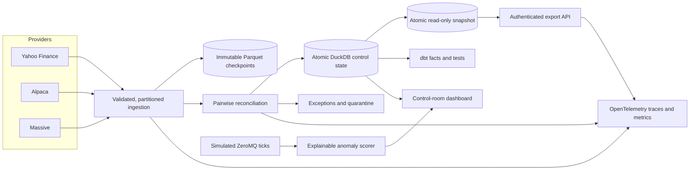
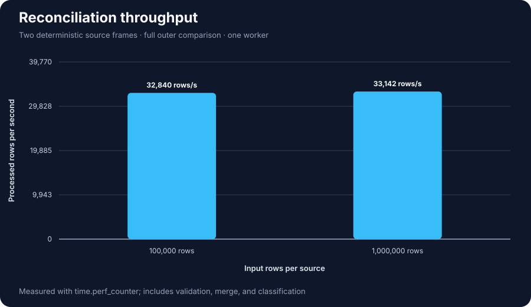
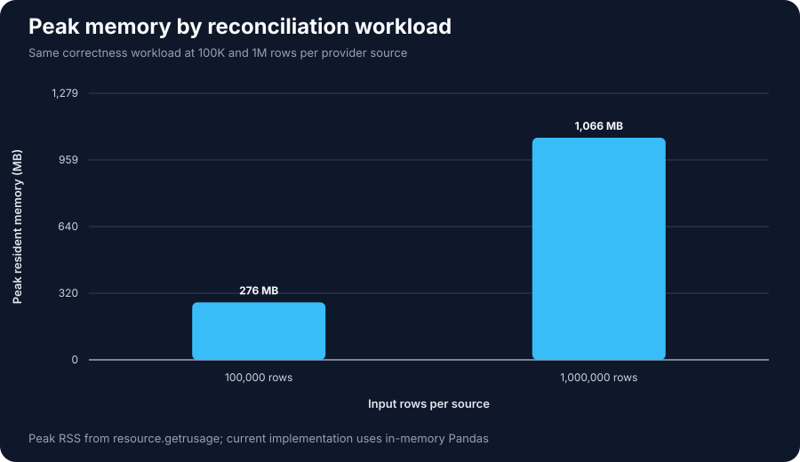
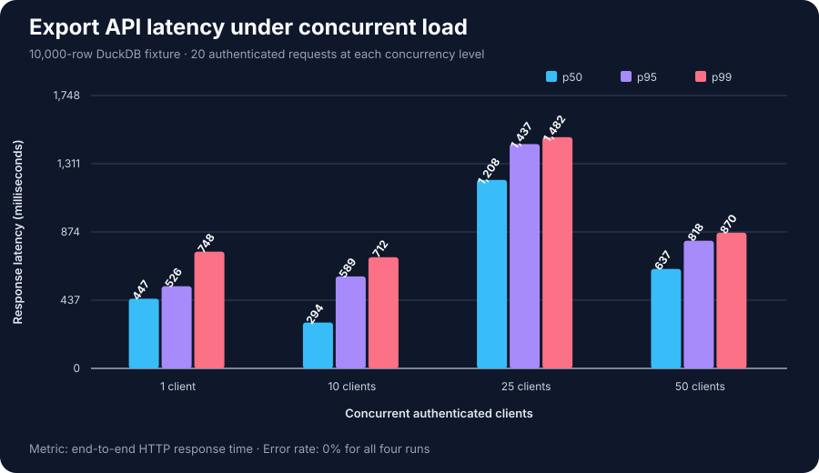

# Automated Financial Data Ingestion & Reconciliation Engine

A Python reconciliation engine for equities, equity options, and futures using Yahoo Finance, Alpaca, and Massive.



The equity three-provider batch is live-verified. The persisted Yahoo/Alpaca
options control and simulated real-time path are implemented and offline-tested.
Futures are library-only, and Airflow remains planned. See the
[Feature Support Matrix](docs/FEATURE_SUPPORT.md) for exact evidence boundaries.

**Navigate:** [Support](#feature-support) · [Results](#verified-performance) ·
[Quick start](#quick-start) · [Example](#example-break) · [API](#api-overview) ·
[Testing](#testing-and-reproducibility) · [Limitations](#limitations-and-roadmap) ·
[Docs](#documentation)

## Feature Support

| Component | v1.0.0 support |
| --- | --- |
| Three-provider equity reconciliation | **Implemented, live verified** |
| Persisted Yahoo/Alpaca options control | **Implemented, offline verified**; live provider run not claimed |
| Futures reconciliation | Library implemented; persisted orchestration planned |
| Export API and atomic snapshots | Implemented and offline/load tested |
| Benchmarks and crash recovery | Implemented and measured |
| OpenTelemetry | Instrumented and offline tested; backend stack not runtime verified |
| Docker batch | Contract tested; image execution not verified on the evidence host |
| Apache Airflow | **Planned; no DAG or runtime included** |

See the [full support matrix](docs/FEATURE_SUPPORT.md) for definitions, evidence,
and deployment boundaries.

## Verified Performance

| Benchmark | Result |
| --- | --- |
| 100K reconciliation rows per source | **32,840 rows/sec** · **3.045 seconds** · **276 MB peak RSS** |
| 1M reconciliation rows per source | **33,142 rows/sec** · **30.173 seconds** · **1.07 GB peak RSS** |
| Correctness oracle | **0 lost records** · **0 duplicate keys** · **100% of deliberate breaks detected** |
| API load at 1, 10, 25, and 50 clients | **0% errors** across every measured concurrency level |
| Crash recovery | **Passed** before archive, after archive, and after atomic commit |
| dbt release gate | **23/23 models and tests passed** |



<p align="center">
  
  
</p>

The raw CSV/JSON evidence, environment metadata, recovery report, and exact
reproduction commands are committed under [`benchmarks/`](benchmarks/README.md).
The 1M case establishes the safe in-memory envelope on the benchmark host;
larger 5M–10M workloads require a future chunked or SQL execution path rather
than the current in-memory Pandas implementation.

## Visual Walkthrough

### 1. Run the batch control

```sh
python -m reconciliation_engine.batch --symbol AAPL
```

The command fetches all three providers, reconciles every provider pair, stores one
auditable `run_id`, and creates exceptions for breaks. This verified example
aligned eight market dates across three providers and produced 24 pairwise
matches with no breaks:


### 2. Start the live control room

Run the scorer, dashboard, and simulated publisher in separate terminals as
shown in the [operator runbook](docs/RUNBOOK.md#6-run-the-real-time-demonstration). The healthy view
combines the latest DuckDB batch state with annotated ZeroMQ ticks:


The batch and real-time panels degrade independently. Synthetic captures for
[batch unavailable](docs/dashboard_demos/batch-unavailable.svg) and
[real-time unavailable](docs/dashboard_demos/realtime-unavailable.svg) are
available without expanding the main page. Exact verification commands and
results are in [Release Evidence](docs/RELEASE_EVIDENCE.md).

## Key Capabilities

- Canonical Yahoo, Alpaca, and Massive ingestion with provider-pair lineage.
- Full-outer equity and option reconciliation with explicit missing-side breaks.
- Immutable Parquet checkpoints, deterministic run IDs, and atomic DuckDB commits.
- Bounded partition concurrency, provider quota control, retries, and quarantine.
- Persisted, idempotent Yahoo/Alpaca option-chain controls verified offline.
- dbt equity facts, exception SLAs, authenticated exports, and serving snapshots.
- Trace-correlated OpenTelemetry signals and an explainable ZeroMQ anomaly demo.
- Repeatable correctness, performance, load, fault, and crash-recovery evidence.

## Control Guarantees

| Concern | Product behavior |
| --- | --- |
| Missing provider observations | Every Yahoo/Alpaca/Massive provider pair uses a full outer comparison. A one-sided observation remains a `BREAK` with the missing provider named explicitly. |
| Provider alignment | All equity providers use the same configured window; Yahoo and Massive request unadjusted prices to align with Alpaca's raw IEX bars. Symbols and dates are normalized, and Python/dbt share hybrid limits: warning above the greater of `$0.01` or `0.10%`, break above the greater of `$0.05` or `0.50%`. |
| Data validation | Equity inputs reject missing columns, nulls, non-numeric OHLCV values, non-finite or negative values, duplicate `symbol/trade_date` keys, and inconsistent OHLC ranges. Numeric fractional aggregate volume is preserved because some providers report it. |
| Safe retries | The control date, sorted symbol universe, and rule version produce a deterministic run ID. A completed retry performs no provider calls or writes. DuckDB commits the run, stages, results, and exceptions in one transaction; interrupted Parquet writes are immutable and resumable. |
| Bounded scale | Symbols use stable hash buckets and each provider/bucket is independently retryable. Worker concurrency is capped, while Massive also enforces its shared calls-per-minute budget. |
| Failure isolation | Timeouts and retryable HTTP failures are bounded; invalid payloads and failed disk writes create auditable quarantine records rather than partial successful runs. |
| Concurrent reads | A completed DuckDB database is copied into a temporary catalog and atomically published for read-only API consumers, keeping active writes off the serving path. |
| Release evidence | CI runs unit/integration tests, dbt checks, Ruff formatting and lint, security scans, recovery/correctness gates, and an offline end-to-end demo. |

Provider alignment does not imply identical prices. IEX versus broader-market
coverage, quote timing, and vendor policies can create legitimate differences;
the warning band keeps small differences visible without treating all of them
as critical breaks.

## Quick Start

The fastest demonstration is completely offline and needs no provider keys:

```sh
python -m venv .venv
. .venv/bin/activate
python -m pip install -r requirements.txt
python -m reconciliation_engine.smoke
python -m benchmarks.run_end_to_end_demo
```

The demo generates deterministic provider frames, injects one break, archives
inputs, reconciles and persists the run, restores its result, exports CSV, and
captures a trace. To run live equities after configuring the owner-only
`project.env` file:

```sh
python -m reconciliation_engine.batch --symbol AAPL --control-date 2026-10-09
```

To run the implemented but not live-verified options path:

```sh
python -m reconciliation_engine.options_batch AAPL 2026-12-18 \
  --control-date 2026-10-13 --db reconciliation.duckdb
```

Replay equity evidence without provider calls with
`python -m reconciliation_engine.batch --replay-run-id <run-id>`. Configuration,
backfills, archive layout, Docker, scheduling, dashboard, and recovery procedures
are in the [operator runbook](docs/RUNBOOK.md).

## Example Break

```text
run_id=demo-run  status=SUCCESS_WITH_BREAKS  comparisons=1,000  breaks=1
symbol=S42  source_a=YAHOO  source_b=ALPACA
status=BREAK  reason=PRICE_DIFFERENCE  close_difference=-2.00
```

Missing provider observations are also retained as `BREAK` records; the engine
does not hide them with an inner join or substitute synthetic market values.

## API Overview

After a reconciliation has been persisted, start the export service:

```sh
python -m reconciliation_engine.api --db reconciliation.duckdb
```

The service provides authenticated run history, reconciliation and exception
filters, and CSV/JSON/Parquet downloads. `/health` is public; all `/api/v1/*`
routes require `Authorization: Bearer <RECONCILIATION_EXPORT_API_KEY>`.

```text
GET /api/v1/runs
GET /api/v1/runs/{run_id}
GET /api/v1/reconciliations
GET /api/v1/exceptions
GET /api/v1/exports?format=csv
GET /health
```

See the [Export API guide](docs/EXPORT_API.md) for filters, pagination, download
examples, authentication, and the DuckDB single-writer operating model.

For API traffic that must not overlap the active batch database, atomically
publish a stable serving snapshot and point the API at it:

```sh
python -m reconciliation_engine.storage.snapshot \
  reconciliation.duckdb snapshots/reconciliation-read.duckdb
python -m reconciliation_engine.api \
  --db snapshots/reconciliation-read.duckdb
```

The publisher builds a complete temporary catalog before replacing the serving
file, so consumers never observe a partially copied database.

## Testing and Reproducibility

```sh
python -m unittest discover -s tests -v
dbt build --project-dir dbt --profiles-dir dbt
python -m benchmarks.benchmark_reconciliation --sizes 100000 1000000
python -m benchmarks.benchmark_recovery
node benchmarks/api_load_test.js
```

CI also checks Ruff formatting/lint, Bandit, dependency vulnerabilities, the
container contract, and the offline end-to-end story. Raw results and the load
fixture procedure are in [Benchmark Evidence](benchmarks/README.md).

## Operations

- **Docker:** `docker compose -f orchestration/docker/compose.yaml run --rm batch`
- **Dashboard:** `python -m reconciliation_engine.dashboard --db reconciliation.duckdb --refresh 0.5`
- **Simulated real time:** start the anomaly scorer, dashboard, and publisher as documented in the runbook.
- **Telemetry and alerts:** enable OTLP export and run `python -m reconciliation_engine.alerts`.
- **Scheduling:** use the documented cron or Windows Task Scheduler entries; Airflow is not included.

The [operator runbook](docs/RUNBOOK.md) owns full configuration, Docker,
ZeroMQ, scheduling, failure recovery, audit queries, and secret-handling
instructions. See [Data Security](docs/DATA_SECURITY.md), [Observability](docs/OBSERVABILITY.md),
and [Data Sources](DATA_SOURCES.md) for their respective contracts.

## Project Structure

```text
Automated-reconciliation-engine/
├── reconciliation_engine/   # Batch, options, API, storage, real-time paths
├── dbt/                     # DuckDB staging and reconciliation models
├── tests/                   # Offline unit and integration evidence
├── benchmarks/              # Workloads, raw results, and labeled charts
├── orchestration/docker/    # Non-root batch image and persistent volume
└── docs/                    # Runbook, support matrix, ADRs, case study
```

See [Codebase Organization](docs/CODEBASE_ORGANIZATION.md) for ownership and
placement rules.

## Limitations and Roadmap

- In-memory reconciliation used about **1.07 GB RSS at 1M rows per source**;
  5M–10M requires a future chunked or SQL path.
- Options persistence is offline-tested, not live-provider verified.
- Futures remain library-only; persisted futures controls are planned.
- DuckDB snapshots are a single-node design, not a distributed serving tier.
- ZeroMQ is a simulated local demonstration without durable delivery.
- Docker and the external telemetry stack were not runnable on the evidence host.
- Airflow, managed secrets, RBAC, TLS, backups, and immutable access auditing
  remain future deployment capabilities.
- Provider entitlements and redistribution licensing remain operator concerns.

## Documentation

| Document | Purpose |
| --- | --- |
| [Feature Support](docs/FEATURE_SUPPORT.md) | Canonical implemented, verified, library-only, and planned boundary |
| [Engineering Case Study](docs/ENGINEERING_CASE_STUDY.md) | Problem, architecture, trade-offs, evidence, and limitations |
| [Architecture Decisions](docs/adr/README.md) | Why DuckDB, Parquet, deterministic IDs, snapshots, ZeroMQ, and bounded workers |
| [Operator Runbook](docs/RUNBOOK.md) | Configuration, live commands, recovery, Docker, scheduling, and audit queries |
| [Current System and Roadmap](docs/SYSTEM_DESIGN_WORKFLOW.md) | Separate current and future architecture diagrams |
| [Release Evidence](docs/RELEASE_EVIDENCE.md) | Live and offline verification claims |
| [v1.0.0 Release Notes](docs/RELEASE_NOTES_V1.0.0.md) | Version scope and intended tag procedure |

Released under the [MIT License](LICENSE).
