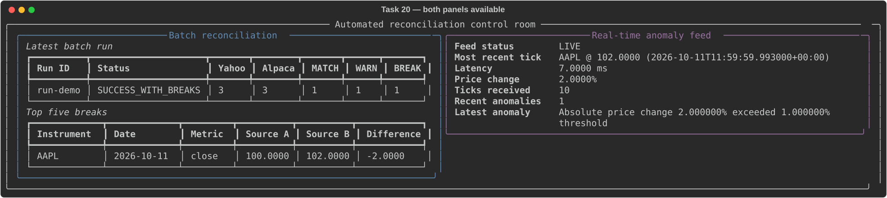
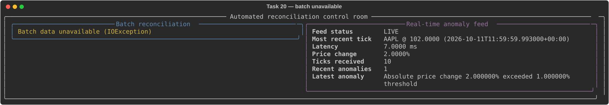
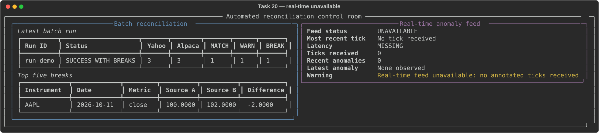

# Dashboard Degraded-Mode Demonstrations

We keep the DuckDB and ZeroMQ read paths independent in the control room. These terminal
captures demonstrate the three required operating modes with synthetic,
non-sensitive data.

## Both Panels Available

## Batch Data Unavailable

## Real-Time Feed Unavailable

For a live demonstration, start the anomaly scorer, the dashboard with
`--refresh 0.5`, and then the simulated publisher. The dashboard never writes
to DuckDB and creates only a ZeroMQ `SUB` socket. The anomaly scorer writes the
append-only event journal. The current screen also includes the investigation
workspace (ingestion health, run history, detailed exceptions, repeat offenders,
quarantines, event sequence health, and trace IDs); the legacy captures above
remain evidence for independent degraded-mode behavior.
