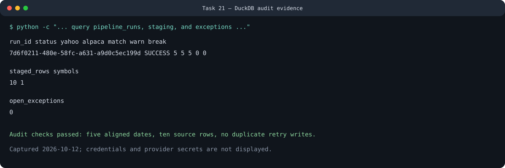

# Release Verification Evidence

Verification was refreshed on October 31, 2026 from the repository root.

We record evidence here, not merely implemented code. We maintain the canonical
current/planned boundary in the [Feature Support Matrix](FEATURE_SUPPORT.md).

## Automated checks

| Check | Result |
| --- | --- |
| Smoke import/schema coverage | Passed in the full suite: 27 release modules and eight required DuckDB tables; no market-data request |
| `python -m unittest discover -s tests -v` | Passed: 128 tests before the table-output addition; the affected transport suite then passed 14/14 |
| `dbt build --project-dir dbt --profiles-dir dbt` | Passed: 23 models/tests, 0 warnings, 0 errors |
| `git diff --check` | Passed |
| Tracked secret/runtime filename check | Passed; only the intentionally tracked `project.env.example` template matched the initial broad search |

We also use a GitHub Actions gate for tests, dbt, Ruff formatting
and lint, Bandit, dependency auditing, the container contract, correctness,
recovery, and a minimal offline end-to-end integration.

## Benchmark, recovery, and load evidence

We keep our reproducible harness and raw results in [the benchmark package](../benchmarks/README.md).

| Verification | Result |
| --- | --- |
| 100K reconciliation | 3.045 s, 32,840 rows/s, 276.04 MB peak RSS |
| 1M reconciliation | 30.173 s, 33,142 rows/s, 1,066.08 MB peak RSS |
| Correctness oracle | No missing rows, duplicate keys, or missed deliberate breaks |
| Process crash boundaries | Passed before archive, after archive, and after commit |
| Logical-run idempotency | Second write rejected; one run remained |
| API load, 1/10/25/50 clients | Zero errors; p50/p95/p99 and throughput committed as CSV |
| Fault injection | Timeout and 429 retry; corrupt input and disk failure quarantined |
| Offline end-to-end demo | 2,000 input rows, one deliberate break, recovery, CSV export, trace |

We use an atomic DuckDB snapshot publisher to separate active batch writes from API
reads. The API load fixture uses the published read-only pattern.

## Live batch and replay

We completed an isolated AAPL batch run against Yahoo, Alpaca, and Massive using temporary storage:

```text
Run ID: 26fc8ab8-34dc-5b8a-941b-6bb3e7435229
Status: SUCCESS
Yahoo rows: 8
Alpaca rows: 8
Massive rows: 8
MATCH: 24
WARN: 0
BREAK: 0
Open exceptions: 0
```

All providers returned the same eight market dates. The three provider pairs produced 24 comparisons. Their largest closing-price difference was approximately `$0.22`, but it remained below the `0.10%` warning band and was correctly classified as a legitimate cross-feed match. An immediate retry returned the same run ID without provider calls or duplicate writes.



## Dashboard evidence

We retain the Task 20 captures as release evidence for the read-only control room:

- [Both batch and real-time panels available](dashboard_demos/both-available.svg)
- [Batch unavailable while real-time remains available](dashboard_demos/batch-unavailable.svg)
- [Real-time unavailable while batch remains available](dashboard_demos/realtime-unavailable.svg)

We also passed two live in-process ZeroMQ integration tests: ten valid simulated ticks and scorer republication of an explained anomaly.

## Network transport evidence

Nineteen deterministic ADR 0007 tests passed using a real IPv4 loopback TCP
listener, local socket pairs, injected multicast sockets, and temporary DuckDB
state. They cover:

- newline-delimited and four-byte network-order length-prefixed TCP frames;
- buffered consecutive frames, bounded frame size, disconnect, and reconnect;
- TLS context wrapping with server-hostname verification configuration;
- IPv4 multicast address validation, group join, datagram receive, and leave;
- common `MarketEvent` validation and deterministic event identity;
- per-source-and-stream `FIRST`, `IN_ORDER`, `GAP`, `DUPLICATE`, and
  `REORDERED` analysis, including equal stream names from different vendors;
- idempotent event journaling with expected/missing sequence evidence;
- narrow TCP and multicast packet-capture filter/command generation; and
- bounded dataframe-style live-table rendering and JSON output compatibility;
  and
- non-retaining continuous monitoring with finite-run compatibility.

Our committed local benchmarks add numerical evidence. Newline and
length-prefixed loopback runs processed 5,957 and 5,823 events/s respectively,
with zero sequence errors. One million interleaved sequences across eight
sources were classified at 102,100 events/s with 100% expected results. A real
midstream disconnect recovered in 11.819 ms, including a configured 10 ms
backoff, with zero events lost. The 10K and 100K continuous-monitor runs retained
zero events and reached 0.602 MiB and 0.737 MiB traced peak heap. Raw results and
reproduction commands are in [Benchmark Evidence](../benchmarks/README.md).

We generated this transport evidence offline. We have not yet exercised an external
vendor endpoint, authentication handshake, entitlement, subscription message,
binary protocol, or live multicast network.

## Environment limitations

- Docker could not be built or run on this host because the `docker` executable is not installed. The Dockerfile, Compose contract, persistent-volume configuration, and secret exclusion tests passed; exact runtime verification commands are published in `benchmarks/README.md`.
- The same limitation prevented actual Collector/Tempo/Prometheus/Grafana execution. In-memory span/metric integration and the full telemetry unit suite passed, but backend screenshots or queries require a Docker-capable host.
- Airflow was not exercised because no Task 18 DAG exists in the repository. It remains planned and is not described as runnable.
- We implemented the persisted Yahoo/Alpaca options command and verified its atomic, idempotent DuckDB workflow with offline provider fixtures. We have not yet exercised it against live option providers.
- We keep Massive options adapters and three-provider comparison helpers experimental and offline-tested. Massive remains outside our persisted options command, and we have not yet verified live snapshot/bar comparability.
- Yahoo/Massive futures ingestion and reconciliation are experimental, library-only, and offline-tested; no persisted futures batch command or live contract/session comparison evidence is included.

