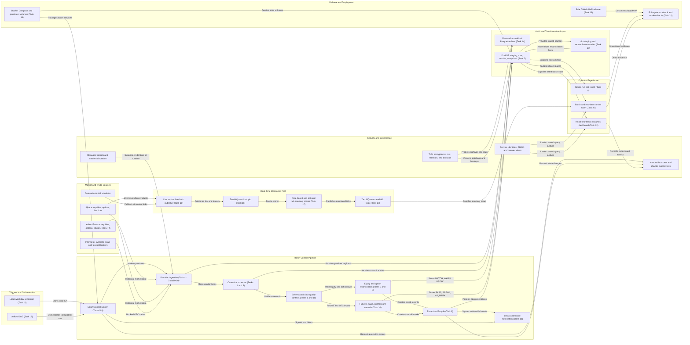
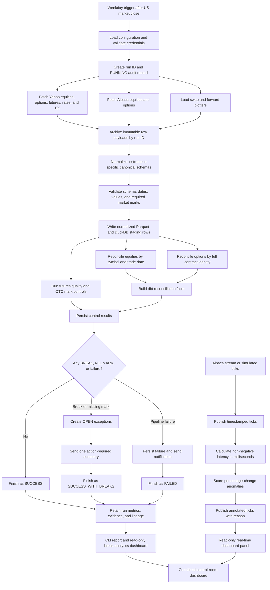
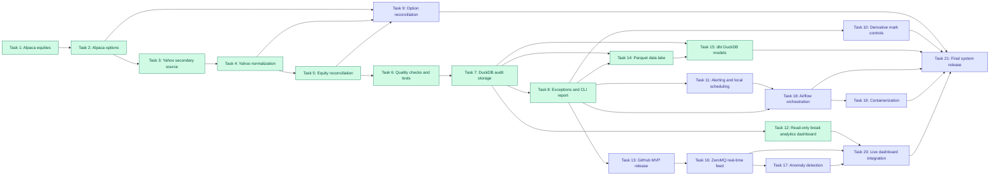

# Automated Reconciliation Engine: System Design and Workflow

This document translates the Task 1–21 specifications in `local_docs/` into an end-state architecture, an operational workflow, and an implementation dependency map.

Tasks 1–8, the DuckDB portion of Task 12, and Tasks 14–15 represent the implemented
local equity-control MVP. Tasks 9–11, 13, and 16–21 extend that MVP toward derivatives,
alerting, real-time monitoring,
orchestration, containerization, and a final reproducible release. Security is
an end-to-end acceptance condition rather than a single isolated task.

## 1. End-State System Architecture

## 2. Daily Batch and Real-Time Workflow

## 3. Task 1–21 Dependency Roadmap

Green nodes are implemented, including the DuckDB break-analytics slice of Task
12, the equity Parquet archive from Task 14, and the dbt transformation layer
from Task 15. Purple nodes remain on the roadmap. Task 20 extends the existing
dashboard with ZeroMQ feed and anomaly panels.

## 4. Core Data Contracts

| Domain | Canonical identity | Main control outcome |
| --- | --- | --- |
| Equity | `symbol, trade_date` | `MATCH`, `WARN`, `BREAK` |
| Option | `underlying, expiry, strike, option_type` | `MATCH`, `WARN`, `BREAK` |
| Future | `symbol, trade_date` | data-quality `PASS` or `BREAK` |
| Swap | `trade_id, trade_date` | booked-versus-market `PASS`, `BREAK`, or `NO_MARK` |
| Forward | `trade_id, trade_date` | booked-versus-market `PASS`, `BREAK`, or `NO_MARK` |
| Real-time tick | `symbol, exchange_timestamp` | normal or explained anomaly |

## 5. Dashboard and Security Acceptance Criteria

| Capability | Local MVP | Shared deployment target |
| --- | --- | --- |
| Break visualization | Latest run, missing observations, largest deltas | Unified cross-instrument views |
| Analytics | Break trend, repeat offenders, exception counts | Age, owner, SLA, provider, rule, and resolution trends |
| Database access | DuckDB read-only connection | Dedicated least-privilege service identity and curated views |
| Secrets | Git-ignored owner-only file, lazy loading | Managed secret store and rotation policy |
| Data protection | Owner-only database file | TLS, encryption at rest, encrypted backups, retention jobs |
| Sensitive fields | Raw staging excluded from dashboard | Role-based masking and export controls |
| Audit | Run and exception lineage | Immutable access, export, rule-change, and admin events |

The batch and real-time paths remain intentionally independent. DuckDB or ZeroMQ can fail without forcing the other dashboard panel to stop, and the dashboard remains a read-only consumer throughout.

The analytics layer is operational rather than predictive: it prioritizes the
current largest mismatches, missing observations, break-rate history, repeat
offenders, exception age, and SLA breaches. Security controls apply end to end:
runtime secret access, encrypted transport/storage, least-privilege curated
views, masking of sensitive trade fields, retention, and immutable audit events.
